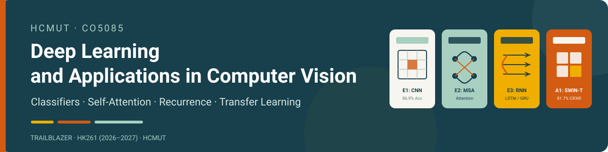

<p align="center">
  <a href="https://khanhhoangduydinh.github.io/CO5085-Deep_Learning_and_Its_Applications_in_Computer_Vision/"></a>
  <a href="https://colab.research.google.com/github/khanhhoangduydinh/CO5085-Deep_Learning_and_Its_Applications_in_Computer_Vision/blob/main/CO5085_Exercises_E1_E2_E3.ipynb"></a>
  <a href="reports/exercises.pdf"></a>
  <a href="CO5085%20Report%20Latex/a1_report.pdf"></a>
  
</p>

# CO5085 — Deep Learning and Its Applications in Computer Vision

This repository contains the course assignments for **CO5085**, Ho Chi Minh City University of Technology — Vietnam National University Ho Chi Minh City, semester HK261 (2026–2027). The project explores core deep learning paradigms for computer vision: classical image classifiers (Softmax, MLP, CNN), multi-head self-attention and Vision Transformers (with custom Manual MSA and tokenizers), recurrent architectures (LSTM, GRU) for sequence-based image modeling, and extensive transfer learning comparisons between CNNs (ResNet-18) and Vision Transformers (Swin-T) on CIFAR-100.

**Group:** Trailblazer · **Author:** Dinh Hoang Duy Khanh (Student ID: 2670306) · **Lecturers:** Dr. Le Thanh Sach, Dr. Nguyen Quoc Minh

## Quick links

| Task | Dataset and problem | Report PDF | Google Colab (Đã chạy hoàn chỉnh) |
| --- | --- | --- | --- |
| **E1: Classifiers** | Fashion-MNIST: compare Softmax linear, MLP, and CNN classifiers with manual training loop | [Exercises Report (PDF)](reports/exercises.pdf) | [Open E1 Colab](https://colab.research.google.com/github/khanhhoangduydinh/CO5085-Deep_Learning_and_Its_Applications_in_Computer_Vision/blob/main/notebooks/e1_image_classifiers.ipynb) |
| **E2: Attention** | Fashion-MNIST: manual multi-head self-attention vs PyTorch MSA, patch/stem/row tokenizers | [Exercises Report (PDF)](reports/exercises.pdf) | [Open E2 Colab](https://colab.research.google.com/github/khanhhoangduydinh/CO5085-Deep_Learning_and_Its_Applications_in_Computer_Vision/blob/main/notebooks/e2_transformer_attention.ipynb) |
| **E3: Sequences** | Fashion-MNIST: row-by-row recurrent sequence modeling (LSTM, GRU) vs CNN baseline | [Exercises Report (PDF)](reports/exercises.pdf) | [Open E3 Colab](https://colab.research.google.com/github/khanhhoangduydinh/CO5085-Deep_Learning_and_Its_Applications_in_Computer_Vision/blob/main/notebooks/e3_image_sequences.ipynb) |
| **A1: Transfer Learning** | CIFAR-100: ResNet-18 vs Swin-T across scratch, head-only, partial, and full fine-tuning | [A1 Report (PDF)](CO5085%20Report%20Latex/a1_report.pdf) | [Open A1 Colab](https://colab.research.google.com/github/khanhhoangduydinh/CO5085-Deep_Learning_and_Its_Applications_in_Computer_Vision/blob/main/notebooks/a1_cnn_vs_transformer.ipynb) |

- [Project website](https://khanhhoangduydinh.github.io/CO5085-Deep_Learning_and_Its_Applications_in_Computer_Vision/) · [Combined Coursework PDF report](reports/exercises.pdf) · [Assignment 1 PDF report](CO5085%20Report%20Latex/a1_report.pdf) · [Combined Coursework Colab Notebook](https://colab.research.google.com/github/khanhhoangduydinh/CO5085-Deep_Learning_and_Its_Applications_in_Computer_Vision/blob/main/CO5085_Exercises_E1_E2_E3.ipynb) · [Assignment specification (exercise-vne.pdf)](exercise-vne.pdf)

## Task details

### 1. Exercise 1 (E1) — Image Classifiers (Softmax, MLP, CNN)

- **Data:** Fashion-MNIST (60,000 training and 10,000 test $28 \times 28$ grayscale images across 10 clothing categories). The training images are partitioned into 48,000 training and 12,000 validation images using seed 42.
- **Approach:** Build and train three standard visual classifiers from first principles using an explicit training loop (`forward -> loss -> backward() -> optimizer.step()`). Compare linear mapping (Softmax), non-linear feature combination with ReLU (MLP), and local spatial inductive bias with 2D convolutions (CNN).
- **Saved results:** On the test set, CNN achieved test accuracy **0.8686** (86.86%), outperforming MLP (**0.8518**) and Softmax Linear (**0.8258**). See [e1_results.json](reports/e1_results.json).
- **Files:** [Google Colab notebook](notebooks/e1_image_classifiers.ipynb) · [Python source](E1/run_e1.py) · [PDF report](reports/exercises.pdf).

### 2. Exercise 2 (E2) — Transformer Attention & Tokenization

- **Data:** Fashion-MNIST with the identical 48,000 / 12,000 / 10,000 split (seed 42).
- **Approach:** Implement Multi-Head Self-Attention (MSA) from scratch (`ManualMSA`) using standard matrix multiplication and softmax scaling ($\text{Attention}(Q, K, V) = \text{softmax}(QK^T / \sqrt{d})V$). The three measured runs compare manual and PyTorch MSA with 4x4 patch tokens, then PyTorch MSA with CNN-stem tokens. The Row tokenizer is implemented and shape-tested separately; it has no recorded benchmark result.
- **Saved results:** PyTorch MSA with CNN-Stem tokenization achieved test accuracy **0.7578** (75.78%), outperforming Patch-based PyTorch MSA (**0.7072**) and Patch-based Manual MSA (**0.7061**). Manual MSA produces numerical results that closely match PyTorch MSA. See [e2_results.json](reports/e2_results.json).
- **Files:** [Google Colab notebook](notebooks/e2_transformer_attention.ipynb) · [Python source](E2/run_e2.py) · [PDF report](reports/exercises.pdf).

### 3. Exercise 3 (E3) — Recurrent Image Sequence Modeling (LSTM & GRU)

- **Data:** Fashion-MNIST with the identical 48,000 / 12,000 / 10,000 split (seed 42).
- **Approach:** Model each 28x28 image as a temporal sequence of 28 steps (each row is a 28-dimensional vector at time step $t$). Train LSTM and GRU networks to classify the sequential stream, and benchmark against the non-recurrent E1 CNN baseline.
- **Saved results:** LSTM achieved test accuracy **0.8201** (82.01%) and GRU achieved **0.8156** (81.56%). While sequential recurrent models learn spatial row-dependencies effectively, the CNN baseline (**0.8686**) remains superior due to 2D translation equivariance. See [e3_results.json](reports/e3_results.json).
- **Files:** [Google Colab notebook](notebooks/e3_image_sequences.ipynb) · [Python source](E3/run_e3.py) · [PDF report](reports/exercises.pdf).

### 4. Assignment 1 (A1) — CNN vs Vision Transformer on CIFAR-100

- **Data:** CIFAR-100 (50,000 training and 10,000 test $32 \times 32$ color images across 100 classes, grouped into 20 coarse superclasses). Images are resized to $96 \times 96$ with ImageNet normalization and data augmentation. Training partition uses a stratified 40,000 / 10,000 split (400 train, 100 val per class).
- **Approach:** Comprehensive benchmark between ResNet-18 (CNN) and Swin-T (Hierarchical Vision Transformer with Shifted Windows) across 4 training modes: `scratch`, `head` (Linear probe), `partial` (deep layer fine-tuning), and `full` (end-to-end fine-tuning).
- **Saved results:** Full fine-tuning achieved validation accuracy **0.8281** for Swin-T and **0.7441** for ResNet-18 on the same validation split. Only the selected Swin-T configuration was then evaluated on the 10,000-image official test set, reaching accuracy **0.8173** (81.73%) and macro F1 **0.8162**. See [a1_results.json](reports/a1_results.json).
- **Files:** [Google Colab notebook](notebooks/a1_cnn_vs_transformer.ipynb) · [Python source](A1/run_a1.py) · [PDF report](CO5085%20Report%20Latex/a1_report.pdf) · [A1 Guide](A1/README.md).

## Model architecture diagrams

Both PDF reports include diagrams traced to the implemented models, with tensor shapes and classifier heads:

- E1: [Softmax, MLP, and CNN](CO5085%20Report%20Latex/architecture/e1_classifiers.png).
- E2: [Tokenizers and self-attention](CO5085%20Report%20Latex/architecture/e2_attention.png), including residual paths and mean pooling.
- E3: [LSTM and GRU](CO5085%20Report%20Latex/architecture/e3_recurrent.png), with the final recurrent output used for classification.
- A1: [ResNet-18](CO5085%20Report%20Latex/architecture/a1_resnet18.png) and [Swin-T](CO5085%20Report%20Latex/architecture/a1_swin_t.png), using the project's 96×96 input and 100-class heads.

Regenerate the vector PDFs and PNG previews, then rebuild the reports:

```bash
python "CO5085 Report Latex/architecture/generate_architectures.py"
cd "CO5085 Report Latex"
latexmk -pdf -interaction=nonstopmode -halt-on-error report.tex a1_report.tex
```

After compilation, copy `CO5085 Report Latex/report.pdf` to `reports/exercises.pdf` so both published E1–E3 links serve the same report. The A1 diagrams follow the [torchvision ResNet](https://docs.pytorch.org/vision/stable/_modules/torchvision/models/resnet.html) and [Swin Transformer](https://docs.pytorch.org/vision/stable/_modules/torchvision/models/swin_transformer.html) implementations used by `A1/run_a1.py`.

## Run a notebook in Google Colab

1. Open any notebook using the **Google Colab** badges or links in the Quick links table above.
2. Every notebook has been pre-executed (**đã chạy hoàn chỉnh**) with full output logs, learning curves, and confusion matrices embedded directly.
3. To re-run from scratch, select **Runtime → Run all**. A GPU runtime (T4 GPU under **Runtime → Change runtime type**) is recommended for faster execution.
4. To save your modifications, select **File → Save a copy in Drive** or save directly to your own GitHub branch.

## Run the project locally

Install dependencies in a virtual environment:

```bash
pip install -r requirements.txt
```

Execute each task from the project root:

```bash
# Coursework Exercises (Fashion-MNIST)
python -m E1.run_e1
python -m E2.run_e2
python -m E3.run_e3

# Assignment 1 Benchmark (CIFAR-100)
python -m A1.run_a1
```

Run test suite:

```bash
pytest
```

## Run the website locally

```bash
python -m http.server 8000
```

Open `http://localhost:8000/` in your browser. The website uses pure static HTML and CSS without any build step.

## Repository structure

```text
├── index.html                         # Landing page website (GitHub Pages)
├── styles.css                         # Landing page responsive styles
├── assets/
│   ├── readme-banner.svg              # SVG banner for repository README
│   └── logo-bachkhoa.png              # Official HCMUT Bach Khoa logo
├── notebooks/
│   ├── e1_image_classifiers.ipynb     # Exercise 1 Colab notebook (executed)
│   ├── e2_transformer_attention.ipynb # Exercise 2 Colab notebook (executed)
│   ├── e3_image_sequences.ipynb       # Exercise 3 Colab notebook (executed)
│   ├── a1_cnn_vs_transformer.ipynb    # Assignment 1 Colab notebook (executed)
│   └── CO5085_Exercises_E1_E2_E3.ipynb# Combined Coursework notebook (executed)
├── CO5085_Exercises_E1_E2_E3.ipynb    # Root master Colab notebook (executed)
├── E1/
│   ├── run_e1.py                      # Exercise 1 Python implementation
│   └── README.md
├── E2/
│   ├── run_e2.py                      # Exercise 2 Python implementation
│   └── README.md
├── E3/
│   ├── run_e3.py                      # Exercise 3 Python implementation
│   └── README.md
├── A1/
│   ├── run_a1.py                      # Assignment 1 Python implementation
│   └── README.md
├── common.py                          # Shared utilities and dataset split
├── reports/
│   ├── exercises.pdf                  # Compiled PDF report for Coursework E1-E3
│   ├── e1_results.json, e2_results.json, e3_results.json
│   ├── a1_results.json                # Execution metrics for 8 CIFAR-100 modes
│   └── figures/                       # Generated figures, curves and confusion matrices
├── CO5085 Report Latex/               # LaTeX sources and compiled PDF reports
│   ├── report.tex, report.pdf         # Coursework E1-E3 LaTeX source and PDF
│   └── a1_report.tex, a1_report.pdf   # Assignment 1 LaTeX source and PDF
├── tests/
│   └── test_co5085_contract.py        # 18 automated contract & integrity tests
├── exercise-vne.pdf                   # Coursework assignment specification
├── pytest.ini                         # Pytest configuration
└── requirements.txt                   # Project Python dependencies
```

## Data sources

- [Fashion-MNIST](https://github.com/zalandoresearch/fashion-mnist) — 70,000 $28\times 28$ grayscale images across 10 clothing categories.
- [CIFAR-100](https://www.cs.toronto.edu/~kriz/cifar.html) — 60,000 $32\times 32$ color images across 100 fine classes (20 coarse superclasses).

## Author

[Dinh Hoang Duy Khanh](https://github.com/khanhhoangduydinh) · Trailblazer · HCMUT
